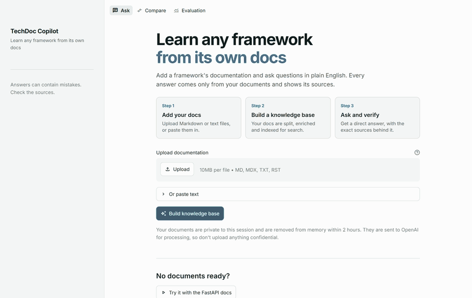
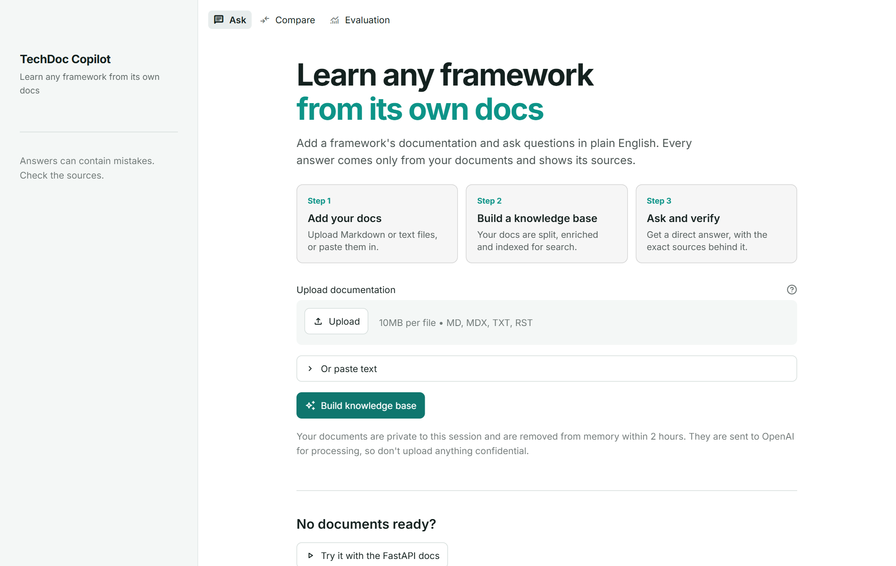
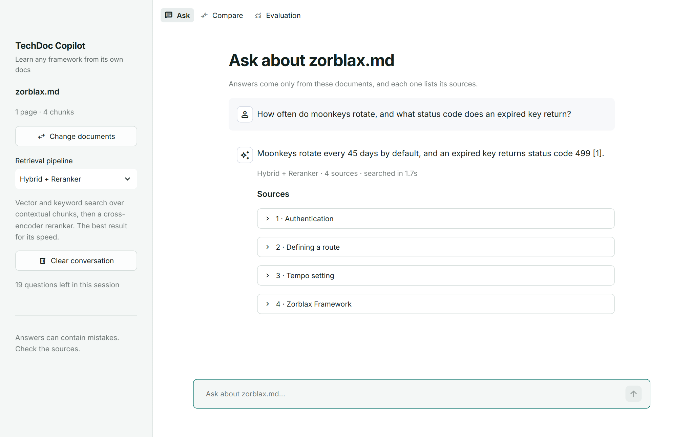
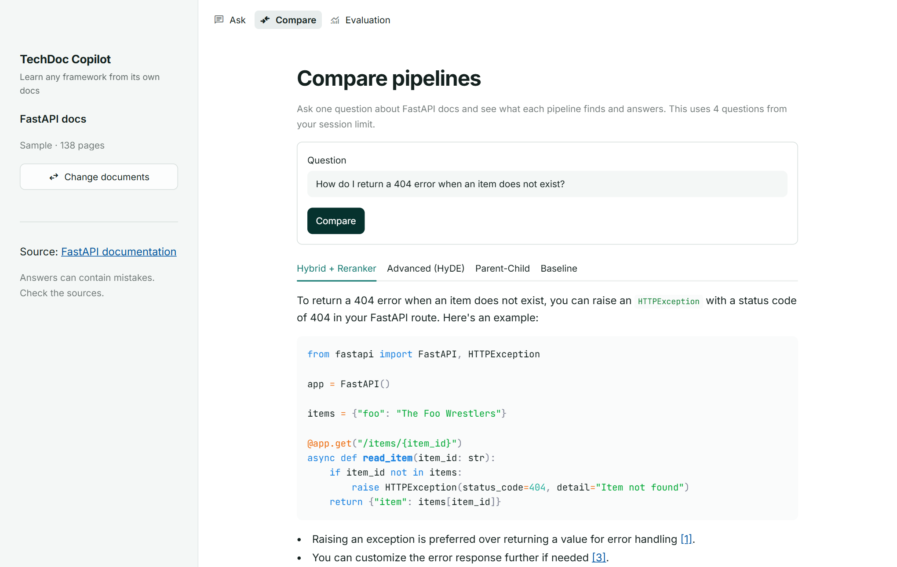
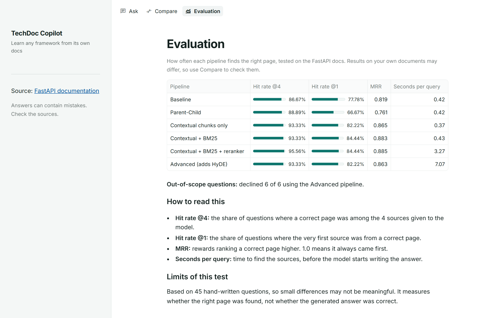
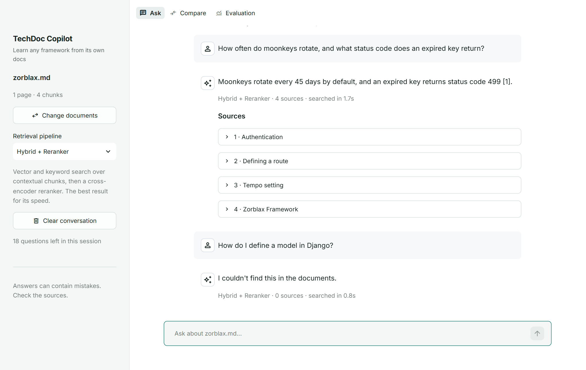
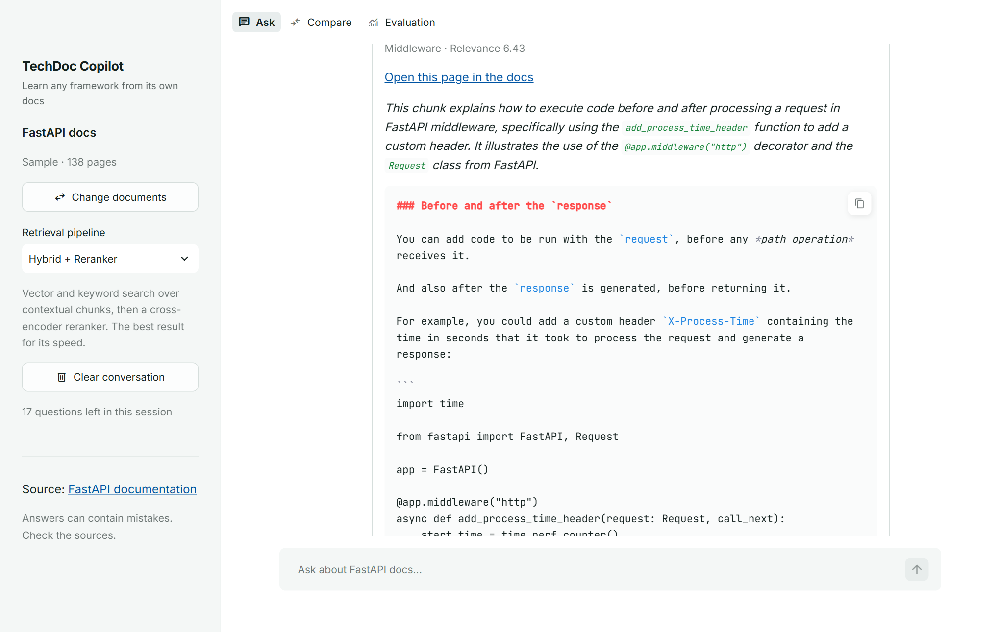
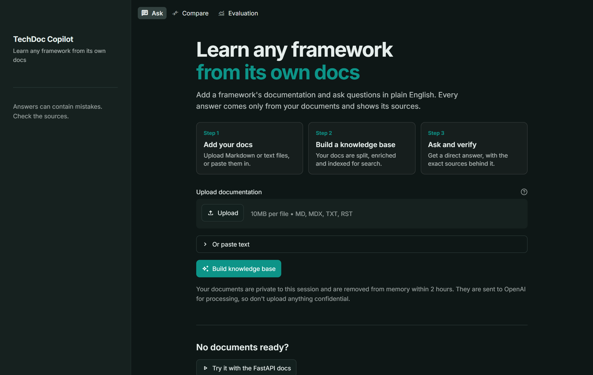
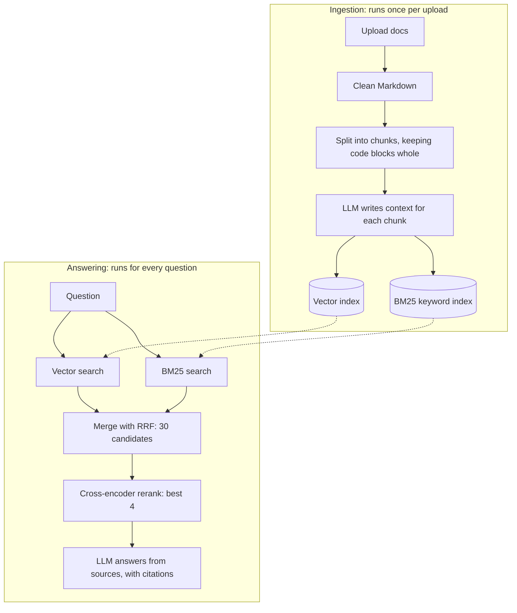

<div align="center">

# TechDoc Copilot

**Upload any framework's documentation. Ask questions. Get answers you can verify.**

A RAG application that answers only from the docs you give it, cites its sources, and says so when the answer isn't there.

[](https://github.com/MoftL/techdoc-copilot/actions/workflows/tests.yml)


[](LICENSE)

### [Explore the interactive demo](https://moftl.github.io/techdoc-copilot/)
*Compare real recorded runs across pipelines. No setup or API key needed.*



</div>

The demo above uses [Zorblax](examples/zorblax.md), a framework invented for testing. It doesn't exist anywhere else, so a correct answer shows the app used the uploaded file and not the model's general knowledge.

## Results

I tested each design on 45 hand-written questions with known correct pages from the FastAPI docs, rather than assuming the most complex design would win.

| Pipeline | Hit rate @4 | First result correct | MRR | Search time |
|---|---:|---:|---:|---:|
| Baseline vector search | 86.7% | 77.8% | 0.819 | 0.42s |
| Parent-child | 88.9% | 66.7% | 0.761 | 0.42s |
| Contextual chunks | 93.3% | 82.2% | 0.865 | 0.37s |
| Contextual + BM25 | 93.3% | 84.4% | 0.883 | 0.43s |
| **Contextual + BM25 + reranker (default)** | **95.6%** | **84.4%** | **0.885** | 3.27s |
| All of the above + HyDE | 93.3% | 82.2% | 0.863 | 7.07s |

**What this showed:**

- **Better chunks gave the clearest gain.** Moving from baseline to contextual chunks found the right page for three more questions out of 45.
- **HyDE didn't earn its place.** A popular technique, but here it doubled search time and added a paid LLM call without improving results, so it's off by default.
- **All 6 out-of-scope questions were declined,** such as "How do I center a div with CSS?"

One question moves hit rate by about 2 points, so close scores are effectively ties. These numbers measure whether search finds the right page, not whether the final answer is correct. The [evaluation notes](docs/ARCHITECTURE.md#evaluation) cover this in more detail.

## See it working

<table>
<tr>
<td width="50%"><br><b>Add your docs.</b> Upload Markdown or text, or paste it in. Each visitor gets a private, temporary knowledge base.</td>
<td width="50%"><br><b>Get cited answers.</b> Each answer cites the sources behind it, which you can open and read.</td>
</tr>
<tr>
<td><br><b>Compare pipelines.</b> Run one question through all four pipelines, on your own documents.</td>
<td><br><b>See the evidence.</b> Evaluation results and their limits are built into the app.</td>
</tr>
</table>

<details>
<summary><b>More screenshots</b></summary>
<br>

**Declining a question the documents don't cover**



**Reading the source behind an answer**



**Dark mode**



</details>

## How it works



<details>
<summary><b>The techniques, and why each one is here</b></summary>
<br>

| Technique | The problem it solves | Result here |
|---|---|---|
| **Structure-aware chunking** | Naive splitting cuts code in half and breaks names like `fastapi.responses` | Code blocks stay whole, and no chunk exceeds its token limit |
| **Contextual retrieval** | A chunk like "set it to True" means little on its own | Part of the largest gain measured |
| **Hybrid search (vectors + BM25)** | Vectors miss exact names such as `HTTPException`, and keywords miss meaning | Better first-result accuracy (82.2% to 84.4%) |
| **Reciprocal Rank Fusion** | Vector and BM25 scores can't be compared directly | Merges by rank instead of score |
| **Cross-encoder reranking** | Fast search is imprecise at the top of the list | Highest hit rate measured (95.6%) |
| **Parent-child retrieval** | Small chunks match well but give the model too little to read | Tested, but ranked correct pages lower here |
| **HyDE** | Questions and documentation are worded differently | Tested, and not used by default |

The [architecture guide](docs/ARCHITECTURE.md) covers each stage and the trade-offs behind it.

</details>

<details>
<summary><b>Engineering problems I found and fixed</b></summary>
<br>

- **The wrong data.** The first index was mostly non-English. The docs crawl held 13 languages, so English questions were matched against Turkish and Hindi text. No code error showed this; it took inspecting the data.
- **Chunking that destroyed code.** Splitting on `.` turned `fastapi.responses` into two fragments, with a median chunk of only 23 tokens. The retrieval stages after it couldn't recover what was lost.
- **Reranker memory.** Replacing PyTorch with ONNX first made things worse, peaking at about 2 GB. Measuring showed the default batch size was the cause. Smaller batches and shorter inputs brought the reranker's peak to 299 MB.
- **Multi-user safety.** A shared index would let one visitor's upload overwrite another's. Each upload now gets an isolated in-memory workspace, with tests proving visitors can't see each other's documents.
- **Budget protection for a public app.** Question and upload limits apply per session and per day, and very large uploads skip the only expensive indexing step.

</details>

## Run it yourself

Requires Python 3.13 and an [OpenAI API key](https://platform.openai.com/api-keys).

```bash
git clone https://github.com/MoftL/techdoc-copilot.git
cd techdoc-copilot
python -m venv venv
source venv/bin/activate   # On Windows: venv\Scripts\activate
pip install -r requirements.txt
cp .env.example .env       # Then add your API key to .env
streamlit run src/app.py
```

The FastAPI sample index is included, so the "Try it with the FastAPI docs" button works straight away. To try your own upload, use [`examples/zorblax.md`](examples/zorblax.md).

<details>
<summary><b>Tests, evaluation, and rebuilding the index</b></summary>
<br>

```bash
# Offline tests. No API key needed, and no paid calls.
pip install -r requirements-dev.txt
pytest tests

# Repeat the evaluation (uses your API key, costing a few cents)
python eval/run_eval.py

# Rebuild the sample index (uses your API key)
python src/build_index.py
```

</details>

Hosting instructions are in the [deployment guide](docs/DEPLOYMENT.md).

## Project structure

```text
src/
├── app.py            Streamlit UI, usage limits, and upload flow
├── build_index.py    Builds the bundled sample index
├── core/             OpenAI client, vector store, and private workspaces
├── ingestion/        Loading, cleaning, chunking, and the three indexers
└── retrieval/        Each pipeline, hybrid search, reranker, and answering
eval/                 Question set, evaluation runner, and results
tests/                Offline tests, including visitor isolation
docs/                 Interactive demo page and technical guides
scripts/              Generates the demo data and screenshots from real runs
```

## Known limitations

- **No follow-up questions yet.** Each question is answered on its own, so "what about the second one?" won't work.
- **A small, self-written test set.** I wrote the 45 questions and used the same set to choose the default, so scores may be optimistic.
- **Search quality is measured, answer quality isn't.** There's no automated check yet that each answer is faithful to its sources.
- **Best with English.** Any language can be uploaded, but the reranker model was trained on English.
- **Text formats only.** PDF and HTML aren't supported yet.
- **Uploads are temporary.** They stay in memory for up to 2 hours, and at most 3 at a time, so a new upload can remove the oldest.
- **Large uploads take time.** The 2 MB English FastAPI docs took about 4.5 minutes to process in testing.

## Acknowledgements

The sample documentation comes from [FastAPI](https://fastapi.tiangolo.com/) by Sebastián Ramírez, under the MIT license. The contextual step is based on Anthropic's [Contextual Retrieval](https://www.anthropic.com/news/contextual-retrieval) approach.

Released under the [MIT License](LICENSE).
