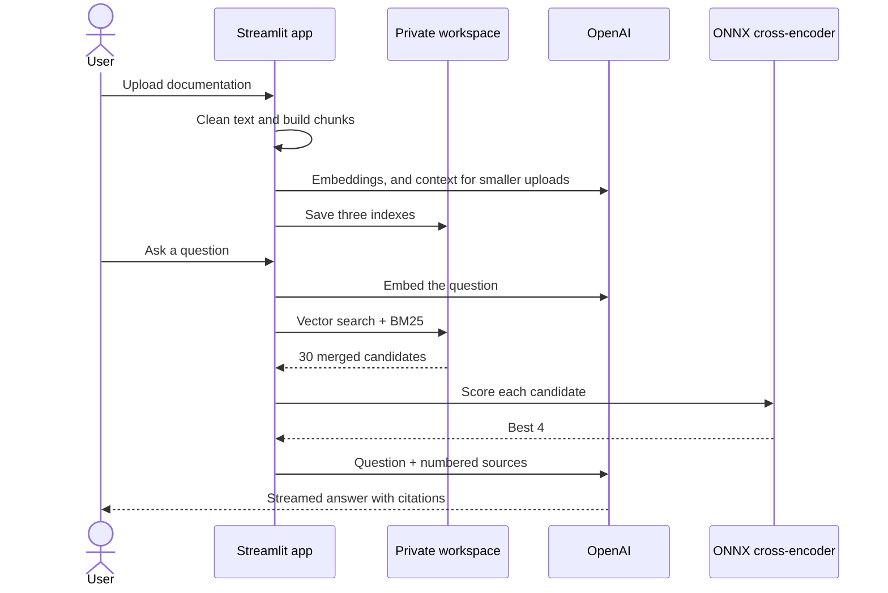
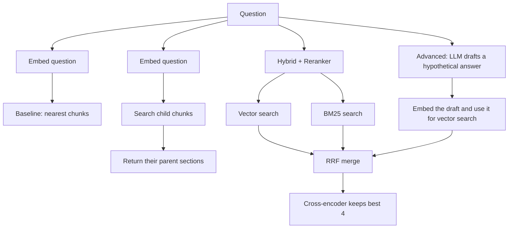

# Architecture

How TechDoc Copilot works, and why each decision was made. For a hands-on version, see the [interactive demo](https://moftl.github.io/techdoc-copilot/).

## Contents

- [Request flow](#request-flow)
- [Ingestion](#ingestion)
- [Retrieval pipelines](#retrieval-pipelines)
- [Answer generation](#answer-generation)
- [Private workspaces](#private-workspaces)
- [Protecting the API budget](#protecting-the-api-budget)
- [Memory](#memory)
- [Evaluation](#evaluation)
- [What I would build next](#what-i-would-build-next)

## Request flow

## Ingestion

### Loading and cleaning

[`loader.py`](../src/ingestion/loader.py) splits a crawl into pages using its `url:` markers. A plain file becomes one page, titled from its first heading or its file name. Cleaning removes permalinks, "Skip to content" links, tab labels, and link targets, but never touches code blocks, because a pattern like `items[0](call)` would otherwise look like a Markdown link.

The bundled sample keeps only English pages and skips project-admin pages such as release notes. Uploads keep every language, because they're the visitor's own documents.

### Chunking

[`chunkers.py`](../src/ingestion/chunkers.py) first breaks text into **blocks**: headings, paragraphs, and whole code blocks. These are the units no strategy may cut through. A block over the size limit is split deliberately: long code by lines, re-wrapped so each piece stays a valid code block, and prose by sentences.

| Strategy | Used by | How it splits | Size |
|---|---|---|---|
| Sliding window | Baseline | Packs blocks up to a limit, and overlaps by repeating whole blocks | 400 tokens, 50 overlap |
| Parent sections | Parent-Child | Splits at headings | Up to 800 tokens |
| Child chunks | Parent-Child | Sliding window inside each parent | 150 tokens, 20 overlap |
| Semantic | Contextual | Splits at headings and topic changes | 120 to 400 tokens |

**Semantic chunking** embeds each block and starts a new chunk where neighboring blocks stop being similar. A topic change only counts once a chunk has reached 120 tokens, which prevents tiny fragments. Code stays attached to the sentence that introduces it.

### Contextual enrichment

Based on Anthropic's Contextual Retrieval, an LLM writes one or two sentences placing each chunk within its page. The title, section path, and context are added to what gets embedded and to the BM25 corpus, but the answer model and reranker see only the original chunk.

This is the only expensive ingestion step, since it makes one LLM call per chunk. Uploads above 40,000 tokens skip it, while still using titles and section paths.

## Retrieval pipelines

Every pipeline returns the same source format and passes 4 sources to the model, which keeps comparisons fair.

- **Baseline** is plain vector search. It's the benchmark everything else must beat.
- **Parent-child** searches small chunks for precision, then gives the model the larger section around each match for context. It removes duplicates so several children can't fill all four slots with one parent.
- **Hybrid search** combines vector search with [BM25](../src/retrieval/hybrid_search.py), which excels at exact terms such as `HTTPException`. The tokenizer uses `\w+`, because the first version's `.split()` kept punctuation attached, so "do?" never matched "do".
- **Reciprocal Rank Fusion** scores each document as the sum of `1 / (60 + rank)` across both lists. It works from rank alone, because cosine similarity and BM25 scores aren't on comparable scales.
- **Reranking** uses a cross-encoder, which reads the question and a passage together. That's more accurate than comparing separate embeddings, but too slow to run across everything, so it only scores the 30 candidates.
- **HyDE** drafts a hypothetical answer and searches with that embedding. BM25 still uses the real question. In testing, it took longer and scored lower, so it's available for comparison but off by default.

## Answer generation

[`answer.py`](../src/retrieval/answer.py) sends numbered sources and instructs the model to use only those sources, cite each claim, include code only when the sources support it, and reply with a fixed message if the answer isn't there. The question is placed in its own tags and treated as a question rather than instructions. This reduces the risk of prompt injection, but doesn't eliminate it.

Citations become links to the source page after streaming finishes. Text inside code is skipped, because `items[1]` there is a Python index.

## Private workspaces

Uploading is the app's main feature, and a public app can have several visitors at once.

- Each upload gets a random workspace ID, and its collections are prefixed with that ID ([`store.py`](../src/core/store.py)).
- The active workspace is set at the start of every page run using a `ContextVar`, so retrieval code doesn't have to pass it around.
- Uploads live in an in-memory Chroma client and are never written to disk by the app.
- The keyword index cache and parent sections are also kept per workspace.
- Workspaces are removed after 2 hours, or when capacity is reached, oldest first ([`workspaces.py`](../src/core/workspaces.py)).

[`test_uploads.py`](../tests/test_uploads.py) checks across all retrieval paths that one workspace can't see another's documents.

**Trade-off:** in-memory storage is simple and private, but uploads don't survive a restart, and this design only works with a single server process. Scaling further would need a shared vector database.

## Protecting the API budget

Anyone can use a public app, and every question costs the owner money.

| Control | Default | Why |
|---|---|---|
| Questions per session | 20 | Limits one visitor |
| Questions per day, all visitors | 300 | Still applies if someone reloads to reset their session |
| Uploads per session / per day | 3 / 30 | Uploading costs more than asking |
| Upload size | 500,000 tokens | Limits cost, memory, and waiting time |
| Context step | Up to 40,000 tokens | Skips the one expensive stage on large files |
| Question length | 500 characters | Keeps requests small |

Counters are held in memory, so they reset on restart. An OpenAI spending limit should always be set as the final backstop.

## Memory

Free hosts offer around 1 GB, which shaped several decisions. All figures were measured on Windows, in a clean install built from `requirements.txt`.

| Setup | Peak memory |
|---|---|
| Reranker with default batch size (ONNX, 30 longest chunks) | 2,011 MB |
| Reranker with batch size 4 and 1,500-character inputs | 299 MB |
| Full app running the sample index, end to end | 668 MB |
| After a 2 MB, 407,000-token upload, then queries | 664 MB |

Importing the reranker lazily also keeps startup light. If three visitors held maximum-size uploads at once, I'd estimate memory could exceed 1 GB, since each added roughly 220 MB in testing. Most uploads will be far smaller, and `MAX_WORKSPACES` can be changed to suit the host.

## Evaluation

[`run_eval.py`](../eval/run_eval.py) runs each pipeline over [45 questions](../eval/questions.json), each listing its correct documentation pages. A hit means a source came from one of those pages.

- **Hit rate @4:** a correct page was among the 4 sources given to the model.
- **First result correct:** the top source was from a correct page.
- **MRR:** the average of `1 / rank` of the first correct page, which rewards ranking it higher.

It tests stages cumulatively, so the contribution of each one is visible. Results are in the [README](../README.md#results) and [`results.json`](../eval/results.json).

**Limits to keep in mind:**

- I wrote the questions, and the same set was used to choose the default, so scores may be optimistic. A separate held-out set would be stronger evidence.
- With 45 questions, one question moves hit rate by about 2.2 points, so close results are ties.
- A hit means the right page was found, not that the chunk contains the answer or that the final answer is correct.
- Contextual results combine semantic chunking with AI context, so the two effects aren't measured separately.
- Results come from the FastAPI docs and may differ on other documentation. The Compare page lets you check your own.
- Search times were measured on one laptop, and exist to compare pipelines rather than predict production speed.

**A known weak spot:** "How do I run some code after sending the response back to the client?" was missed by every pipeline. It's worded very differently from the Background Tasks page it should find.

## What I would build next

1. **Answer-quality evaluation:** check each answer's faithfulness to its sources, and create a held-out test set.
2. **Follow-up questions:** rewrite each question using the conversation so far before searching.
3. **Separate measurement of semantic chunking and AI context:** to find out which actually drives the gain.
4. **More input formats:** PDF, HTML, and fetching docs directly from a URL.
5. **Persistent storage:** a shared vector database, so uploads survive restarts and multiple servers can run.
